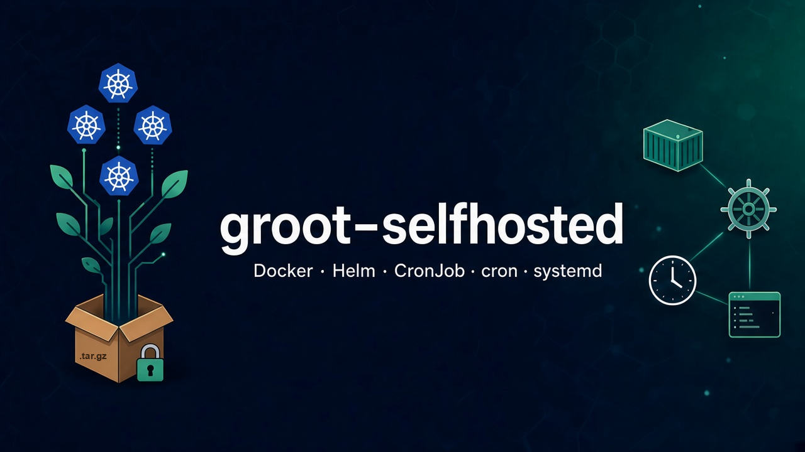

<a id="readme-top"></a>

# groot-selfhosted — run GROOT in your environment

[](./VERSION)
[](https://github.com/hrodrig/groot-selfhosted/releases)
[](./LICENSE)
[](https://github.com/hrodrig/groot/pkgs/container/groot)
[](https://github.com/hrodrig/groot)
[](https://github.com/hrodrig/groot-selfhosted/actions/workflows/ci.yml)
[](https://github.com/hrodrig/groot/releases)
[](https://gghstats.hermesrodriguez.com/hrodrig/groot-selfhosted)

**Repo:** [github.com/hrodrig/groot-selfhosted](https://github.com/hrodrig/groot-selfhosted) · **Releases:** [GitHub Releases](https://github.com/hrodrig/groot-selfhosted/releases) · **App:** [groot](https://github.com/hrodrig/groot) · **Spec:** [SPECIFICATIONS.md](https://github.com/hrodrig/groot/blob/main/SPECIFICATIONS.md) · **Changelog:** [CHANGELOG.md](CHANGELOG.md) · **Run index:** [run/README.md](run/README.md)



**Product:** [github.com/hrodrig/groot](https://github.com/hrodrig/groot) — CLI, SPEC, releases, and **`ghcr.io/hrodrig/groot`** image.  
**This repo:** how to **deploy and schedule** GROOT (bastion, container, in-cluster CronJob).

GROOT is a **read-only Kubernetes log collector**. This repository holds **operator** material only: Helm chart, flat manifests, Docker/Podman runbooks, and cron/systemd wrappers. For install channels (deb, rpm, Homebrew, `go install`), see the [groot README](https://github.com/hrodrig/groot/blob/main/README.md).

| This repo ships | App behavior lives in |
|-----------------|------------------------|
| Helm chart, flat manifests, Docker/Podman, cron/systemd, example configs | CLI, SPEC, `ghcr.io/hrodrig/groot`, binaries, `.deb` / `.rpm` — [groot](https://github.com/hrodrig/groot) |
| In-cluster CronJob and bastion `docker run` | Collect / validate / inspect — [SPECIFICATIONS.md](https://github.com/hrodrig/groot/blob/main/SPECIFICATIONS.md) |
| Private-registry mirror steps | Image publish — [groot Releases](https://github.com/hrodrig/groot/releases) |

**Upstream pin:** `ghcr.io/hrodrig/groot:v1.2.1` · [SPEC](https://github.com/hrodrig/groot/blob/main/SPECIFICATIONS.md) · [sample config](https://github.com/hrodrig/groot/blob/main/configs/groot.yml.sample)

**Related tools (same maintainer):**
- **[pgwd](https://github.com/hrodrig/pgwd)** — PostgreSQL connection watchdog ([live traffic](https://gghstats.hermesrodriguez.com/hrodrig/pgwd); deploy: [pgwd-selfhosted](https://github.com/hrodrig/pgwd-selfhosted))
- **[gghstats](https://github.com/hrodrig/gghstats)** — GitHub repo traffic beyond 14 days ([live demo](https://gghstats.hermesrodriguez.com); deploy: [gghstats-selfhosted](https://github.com/hrodrig/gghstats-selfhosted))
- **[kzero](https://github.com/hrodrig/kzero)** — bastion-first declarative workload reset ([live traffic](https://gghstats.hermesrodriguez.com/hrodrig/kzero); deploy: [kzero-selfhosted](https://github.com/hrodrig/kzero-selfhosted))
- **[groot](https://github.com/hrodrig/groot)** — Kubernetes diagnostics archive ([live traffic](https://gghstats.hermesrodriguez.com/hrodrig/groot); deploy: [groot-selfhosted](https://github.com/hrodrig/groot-selfhosted))

---

## Table of contents

- [Where to run GROOT](#where-to-run-groot)
- [Quick start (Helm)](#quick-start-helm)
- [Versioning](#versioning)
- [Community and policies](#community-and-policies)
- [License](#license)

---

## Where to run GROOT

| Mode | Path | When |
|------|------|------|
| **Docker / Podman** (bastion) | [run/docker/README.md](run/docker/README.md) | Laptop or jump host with kubeconfig |
| **Helm CronJob** (in-cluster) | [run/deploy/README.md](run/deploy/README.md) | Scheduled collection inside the cluster |
| **HTTP on-demand** | **[groot-trigger](https://github.com/hrodrig/groot-trigger)** | Idle API → collect Job (not this repo) |
| **On-demand Deployment** | [run/deploy/k8s/ondemand-deployment.yaml](run/deploy/k8s/ondemand-deployment.yaml) | Pod in `groot` namespace; `kubectl exec` to collect |
| **Flat CronJob YAML** | [run/deploy/k8s/cronjob.yaml](run/deploy/k8s/cronjob.yaml) | Scheduled collection without Helm |
| **cron / systemd** (standalone binary) | [run/standalone/README.md](run/standalone/README.md) | Host scheduler + Releases binary |
| **Kubernetes, no egress** | [run/deploy/private-registry.md](run/deploy/private-registry.md) | Mirror the chart and image, then install from your registry |
| **Example configs** | [run/examples/](run/examples/) | Minimal operator YAML |

Start at **[run/README.md](run/README.md)** for the full index.

**[↑ Contents](#table-of-contents)**

---

## Quick start (Helm)

**Naming:** this repository is **`groot-selfhosted`**. The chart lives under **`run/deploy/helm/groot/`** — chart name **`groot`** (see **`Chart.yaml`**). **`index.yaml`** and **`groot-<chart-version>.tgz`** are on [GitHub Pages](https://hrodrig.github.io/groot-selfhosted/index.yaml) — see [CONTRIBUTING.md](CONTRIBUTING.md).

**Install from the Helm repo:**

```bash
helm repo add groot https://hrodrig.github.io/groot-selfhosted
helm repo update
helm search repo groot -l
helm upgrade --install groot groot/groot \
  --namespace groot --create-namespace \
  --set image.tag=v1.2.1
```

Use **`--version`** from **`helm search`**. If **`helm repo add`** fails, use the clone path below.

**Install from a clone (no Helm repo required):**

```bash
git clone https://github.com/hrodrig/groot-selfhosted.git
cd groot-selfhosted
helm upgrade --install groot ./run/deploy/helm/groot \
  --namespace groot --create-namespace \
  --set image.tag=v1.2.1
```

See [run/deploy/README.md](run/deploy/README.md) for custom config, PVC, and RBAC notes.

To install from a private registry, mirror the chart and the image first, then point Helm at that registry. Steps: [private-registry.md](run/deploy/private-registry.md).

**[↑ Contents](#table-of-contents)**

---

## Versioning

| Field | Meaning |
|-------|---------|
| Root **`VERSION`** | This operator repo (tags `v…` on `main`). Not the groot CLI version. |
| Helm **`Chart.yaml` `version:`** | Chart package (`groot-<chart-version>.tgz` on [Pages](https://hrodrig.github.io/groot-selfhosted/index.yaml)). Bump only when `run/deploy/helm/groot/` changes. May lag **`VERSION`**. |
| Helm **`appVersion`** | **groot** image line. Empty `image.tag` uses this value. |
| Docs / `image.tag` | Published GHCR tag. Current pin: **`ghcr.io/hrodrig/groot:v1.2.1`**. Bare `:1.2.1` is not published. |

**[↑ Contents](#table-of-contents)**

---

## Community and policies

| Document | Purpose |
|----------|---------|
| **[CHANGELOG.md](CHANGELOG.md)** | Release history for **this** repository (manifests, docs, chart). |
| **[CONTRIBUTING.md](CONTRIBUTING.md)** | Scope (operator vs product), PR flow, release notes. |
| **[CODE_OF_CONDUCT.md](CODE_OF_CONDUCT.md)** | Community standards (Contributor Covenant). |
| **[SECURITY.md](SECURITY.md)** | Where to report product vs operator vulnerabilities. |
| **[AGENTS.md](AGENTS.md)** | Guidelines for AI coding agents working in this repo. |

**Application** issues (CLI, collector, image) belong in **[groot](https://github.com/hrodrig/groot)** — not here.

**[↑ Contents](#table-of-contents)** · **[↑ Top](#readme-top)**

---

## License

MIT — see [LICENSE](./LICENSE).

**[↑ Contents](#table-of-contents)** · **[↑ Top](#readme-top)**
