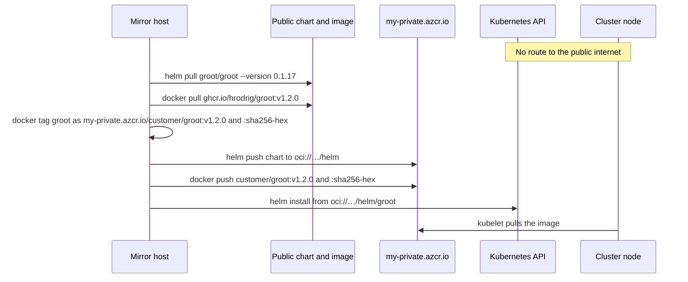

# Private registry — cluster with no egress

A private cluster often blocks outbound traffic from the nodes and from the admin bastion. AKS is one example. The same steps apply to any cluster that cannot reach the public chart site or `ghcr.io`.

Mirror the chart and the image once, from a machine that **does** have egress, into a registry the cluster can reach. After that, install and run only talk to that registry.

The names below are a stand-in for one private Azure Container Registry. A real ACR host is `<name>.azurecr.io`. Harbor, Artifactory, or any other OCI registry uses the same chart path and image path: `oci://<registry>/helm/groot` and `<registry>/customer/groot`.

| What | Public source | Private example |
|------|----------------|-----------------|
| Chart `groot` `0.1.17` | `https://hrodrig.github.io/groot-selfhosted/` | `oci://my-private.azcr.io/helm/groot` |
| Collector image | `ghcr.io/hrodrig/groot:v1.2.0` | `my-private.azcr.io/customer/groot:v1.2.0` |
| Same image, digest tag | repo digest of that pull | `my-private.azcr.io/customer/groot:sha256-<hex>` |

Prefer a normal tag (`v1.2.0`) in Helm values. The `sha256-<hex>` tag is the alternative when policy refuses a tag that can move. The hex is the digest of the image you pulled, with `sha256:` rewritten to `sha256-` because a tag cannot contain a colon.

The Helm chart and the flat [CronJob](k8s/cronjob.yaml) pull that one image. The on-demand [Deployment](k8s/ondemand-deployment.yaml) does not: its init container downloads a GitHub release tarball with `curlimages/curl`, then sleeps in `busybox`. A locked cluster should use the chart or the CronJob. Do not point that init container at `github.com`.



The mirror host is a laptop or a build agent with egress. It is not the locked bastion.

## 1. Log in

```bash
docker login my-private.azcr.io
helm registry login my-private.azcr.io
```

How the kubelet authenticates is specific to the cluster. On AKS, attaching the registry (`az aks update --attach-acr`) is one way to pull without a pull secret. The chart accepts `image.pullSecrets` when the cluster has no built-in registry integration. Those secrets are copied onto the Job ServiceAccount, so a [groot-trigger](https://github.com/hrodrig/groot-trigger) Job that reuses that account can pull the same image. The trigger image itself is a separate repository (`ghcr.io/hrodrig/groot-trigger`); mirror it on its own if the trigger pods also have no egress.

## 2. Chart

On the mirror host:

```bash
helm repo add groot https://hrodrig.github.io/groot-selfhosted/
helm repo update
helm pull groot/groot --version 0.1.17
helm push groot-0.1.17.tgz oci://my-private.azcr.io/helm
```

`helm pull` writes `groot-0.1.17.tgz` in the current directory. Push that file. Do not point the cluster at `hrodrig.github.io`.

## 3. Image

Suggested tag. Pull the architecture the nodes run (`--platform linux/amd64` on an arm64 laptop if the pool is amd64). `docker push` of a plain pull copies that one architecture, not the whole multi-arch index.

```bash
docker pull --platform linux/amd64 ghcr.io/hrodrig/groot:v1.2.0
docker tag ghcr.io/hrodrig/groot:v1.2.0 my-private.azcr.io/customer/groot:v1.2.0
docker push my-private.azcr.io/customer/groot:v1.2.0
```

### Digest tag

[mirror-groot-image.sh](mirror-groot-image.sh) pulls one `name:tag`, keeps that tag on the destination, and also pushes `sha256-<hex>` from `RepoDigests`.

```bash
chmod +x mirror-groot-image.sh
./mirror-groot-image.sh \
  ghcr.io/hrodrig/groot:v1.2.0 \
  my-private.azcr.io/customer/groot
```

The script prints both refs. Use the `v1.2.0` line in values unless policy requires the digest tag. Re-run after every upstream image change. The hex changes when the bytes change.

The same script can mirror any other `name:tag` (for example `curlimages/curl` or `busybox` if you still run the on-demand Deployment). Pass the source ref and the destination repository with no tag.

## 4. Install from the private registry

The Helm client must reach the private registry and the API server. It does not need GHCR.

```bash
helm install groot oci://my-private.azcr.io/helm/groot --version 0.1.17 \
  --namespace groot --create-namespace \
  --set image.repository=my-private.azcr.io/customer/groot \
  --set image.tag=v1.2.0 \
  --set 'image.pullSecrets[0].name=YOUR_PULL_SECRET'
```

Omit `image.pullSecrets` when the cluster already trusts the registry (AKS `--attach-acr` is one case).

Digest tag instead of `v1.2.0`:

```bash
--set image.tag=sha256-<hex>
```

Leave `image.tag` empty only when `image.repository` is still `ghcr.io/hrodrig/groot`. Empty means `Chart.appVersion` (`v1.2.0`) on that public repository.

Flat CronJob: set `image:` in [k8s/cronjob.yaml](k8s/cronjob.yaml) to the same private ref before apply. Do not apply the CronJob and the on-demand Deployment against one PVC.
